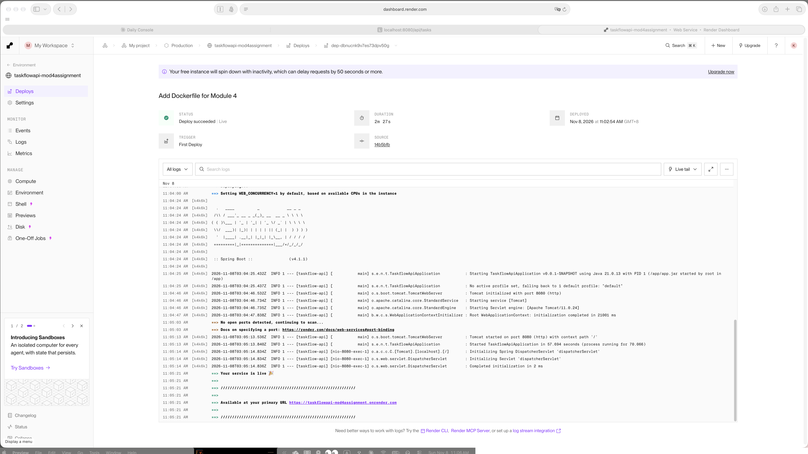
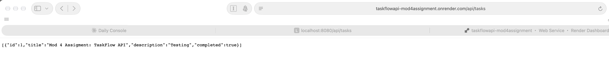

# TaskFlow API – Dockerized & Deployed

Module 4 End of Module Assignment – NTU AI Engineering

## Live Application URL

https://taskflowapi-mod4assignment.onrender.com/api/tasks

Deployed on: Render (Free instance, Singapore region)

> The free instance spins down when idle, so the first request can take about a minute while it wakes up.

## How It's Built

- Spring Boot 4.1 REST API (Java 21) from Module 3, with an AI task summary powered by Spring AI + OpenAI
- Multi-stage Dockerfile: Stage 1 builds the JAR with Maven, Stage 2 runs it on a slim Java 21 JRE (Alpine) image
- Render builds the image from the Dockerfile in this repo on every push to `main`
- Tasks are stored in memory, so the list resets whenever the service restarts

## API Endpoints

| Method | Path | Description |
|---|---|---|
| GET | `/api/tasks` | List all tasks |
| POST | `/api/tasks` | Create a task |
| GET | `/api/tasks/{id}` | Get one task |
| PUT | `/api/tasks/{id}` | Update a task |
| DELETE | `/api/tasks/{id}` | Delete a task |
| PUT | `/api/tasks/{id}/complete` | Mark a task as completed |
| GET | `/api/tasks/summary` | AI-generated summary of tasks (needs `OPENAI_API_KEY`) |

Example – create a task (the `completed` field is required):

```bash
curl -X POST https://taskflowapi-mod4assignment.onrender.com/api/tasks \
  -H "Content-Type: application/json" \
  -d '{"title": "Test task", "description": "From Docker", "completed": false}'
```

## Run Locally with Docker

```bash
docker build -t taskflow:latest .
docker run -d --name taskflow -p 8080:8080 -e OPENAI_API_KEY="$OPENAI_API_KEY" taskflow:latest
curl http://localhost:8080/api/tasks
```

`-e OPENAI_API_KEY="$OPENAI_API_KEY"` passes the key from your own shell environment into the container. It is only needed for `/api/tasks/summary`; never commit the key itself.

To stop and remove the container: `docker rm -f taskflow`

## Screenshots

### Deployment dashboard


### Live application


## Errors and Failures

All four tasks were completed and the app is live. These are the issues I ran into along the way and how I fixed them:

1. **Port already in use when running the container**
   ```
   docker: Error response from daemon: ports are not available: exposing port TCP 0.0.0.0:8080 -> 127.0.0.1:0: listen tcp 0.0.0.0:8080: bind: address already in use
   ```
   The app was still running locally via `./mvnw spring-boot:run`. Stopping it freed port 8080.

2. **Container stopped before I could test it**
   ```
   curl: (7) Failed to connect to localhost port 8080 after 0 ms: Couldn't connect to server
   ```
   `docker run` runs in the foreground, and pressing Ctrl+C stopped the container (`Exited (130)`). Running it in the background with `-d` fixed this.

3. **Request sent before the app finished starting**
   ```
   curl: (56) Recv failure: Connection reset by peer
   ```
   `curl` ran immediately after `docker run -d`, before Spring Boot had started. Waiting a few seconds fixed it.

4. **Render reported "No open ports detected" during the first deploy**
   On the free instance, Spring Boot took about 58 seconds to start, so Render's port scan ran before Tomcat was listening. It found port 8080 once startup finished, and the deploy succeeded without any changes.

5. **AI summary endpoint returns 500**
   ```
   com.openai.errors.RateLimitException: 429: You have no credits remaining.
   ```
   `/api/tasks/summary` calls the OpenAI API, and the account has no credits. All other endpoints work; this one needs a funded `OPENAI_API_KEY` (also set as an environment variable on Render).
